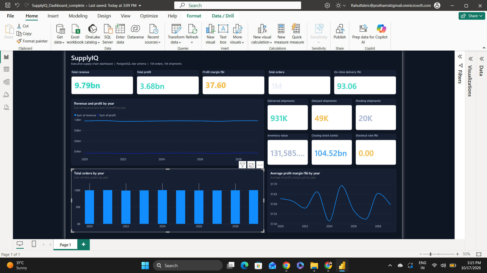

# SupplyIQ 2.0: Supply Chain Analytics Platform



SupplyIQ 2.0 is an end-to-end supply chain analytics project. It models sales, inventory, procurement, shipments and returns in PostgreSQL (about 4.6M fact records), exposes KPIs through SQL analytical views, and reports them in a Power BI executive dashboard. Data is generated with Python scripts, and the database runs in Docker.

> **Note:** All data in this project is **synthetic**, produced by the scripts in `scripts/`. Figures are for demonstrating the pipeline and are not real business results.

## Dashboard

The Power BI report (`powerbi/SupplyIQ_Executive_Dashboard.pbix`) connects to PostgreSQL and shows:

- **Executive KPIs:** total revenue, total profit, profit margin (%), total orders and on-time delivery (%).
- **Shipments:** delivered, delayed and pending shipment counts.
- **Inventory:** inventory value, closing stock and stockout rate.
- **Trends by year:** revenue and profit, total orders, and average profit margin.

The report reads these SQL views: `vw_executive_kpis`, `vw_monthly_executive_performance`, `vw_delivery_performance`, `vw_profitability_summary`, `vw_inventory_health` and `vw_supply_chain_scorecard`.

## Key Features

- **Dimensional data model:** dimensions for dates, products, suppliers, customers, warehouses and carriers.
- **Fact tables:** sales, inventory, procurement, shipments and returns.
- **Analytical SQL:** executive KPIs plus views for sales and demand, inventory, procurement, logistics, supplier performance, customer analytics and supply chain risk.
- **Data generation:** Python scripts that create the dimension and fact data.
- **Containerized database:** PostgreSQL managed with Docker Compose.
- **Reporting:** Power BI executive dashboard.

## Tech Stack

| Area | Tools |
|---|---|
| Database | PostgreSQL |
| Languages | SQL, Python |
| Data tooling | pandas, SQLAlchemy, NumPy, Faker, uv |
| Containers | Docker, Docker Compose |
| BI / visualization | Microsoft Power BI |

## Data Model

**Dimensions:** `dim_date`, `dim_product`, `dim_supplier`, `dim_customer`, `dim_warehouse`, `dim_carrier`

**Fact tables:** `fact_sales`, `fact_inventory`, `fact_procurement`, `fact_shipments`, `fact_returns`

The dataset is designed to hold about 4.6 million fact records across the five fact tables. Actual row counts depend on the generation scripts and your local database.

## Analytics

| File | Focus |
|---|---|
| `sql/01_executive_kpis.sql` | Executive KPIs |
| `sql/02_sales_demand.sql` | Sales and demand analysis |
| `sql/03_inventory.sql` | Inventory health |
| `sql/04_procurement.sql` | Procurement analytics |
| `sql/05_logistics.sql` | Shipment and delivery performance |
| `sql/06_supplier_performance.sql` | Supplier performance |
| `sql/07_customer_analytics.sql` | Customer analytics |
| `sql/08_supply_chain_risk.sql` | Supply chain risk |
| `sql/fix_monthly_executive_performance_test.sql` | Monthly executive performance view fix/test |

These views cover revenue, profit, profit margin, inventory value and stock levels, procurement spend, delivery performance, returns, and supplier and customer performance.

## Repository Structure

```
supplyiq/
├── database/
│   └── schema.sql
├── docs/
│   └── dashboard.png
├── powerbi/
│   └── SupplyIQ_Executive_Dashboard.pbix
├── scripts/
│   ├── generate_dimensions.py
│   ├── generate_sales.py
│   ├── generate_inventory.py
│   ├── generate_procurement.py
│   ├── generate_shipments.py
│   └── generate_returns.py
├── sql/
│   ├── 01_executive_kpis.sql
│   ├── 02_sales_demand.sql
│   ├── 03_inventory.sql
│   ├── 04_procurement.sql
│   ├── 05_logistics.sql
│   ├── 06_supplier_performance.sql
│   ├── 07_customer_analytics.sql
│   ├── 08_supply_chain_risk.sql
│   └── fix_monthly_executive_performance_test.sql
├── src/
│   └── supplyiq/
├── .env.example
├── docker-compose.yml
├── pyproject.toml
├── uv.lock
└── README.md
```

## Getting Started

### Prerequisites

- Git
- Docker Desktop with Docker Compose
- Python (version in `.python-version` / `pyproject.toml`)
- [uv](https://docs.astral.sh/uv/)
- Power BI Desktop (to open the report)

### 1. Clone the repository

```bash
git clone https://github.com/prarahul/supplyiq.git
cd supplyiq
```

### 2. Configure environment variables

```powershell
Copy-Item .env.example .env
```

Edit `.env` so the database values match `docker-compose.yml`. Never commit `.env` or real credentials. The connection URL looks like this:

```
postgresql+psycopg2://<username>:<password>@127.0.0.1:<host-port>/<database>
```

Use the host port defined in `docker-compose.yml`.

### 3. Start PostgreSQL

```bash
docker compose up -d
docker compose ps
```

### 4. Create the schema

```bash
docker exec -i <container-name> psql -U <username> -d <database> < database/schema.sql
```

Replace the placeholders with the values from your `docker-compose.yml` and `.env`.

### 5. Install Python dependencies

```bash
uv sync
```

### 6. Generate data

Run the scripts from the project root, in this order:

```bash
uv run python scripts/generate_dimensions.py
uv run python scripts/generate_sales.py
uv run python scripts/generate_inventory.py
uv run python scripts/generate_procurement.py
uv run python scripts/generate_shipments.py
uv run python scripts/generate_returns.py
```

> The scripts may append records. Check row counts before running them against a database that already has data, or you may create duplicates.

### 7. Create the analytical views

Run the files in `sql/` against the `supplyiq` schema, starting with `01_executive_kpis.sql`. Review `fix_monthly_executive_performance_test.sql` before applying it, as it patches the monthly performance view.

### 8. Open the Power BI report

Open `powerbi/SupplyIQ_Executive_Dashboard.pbix` in Power BI Desktop. The report is configured for a local PostgreSQL server at `127.0.0.1:5433`. If your host or port differs, update the data source (Home, then Transform data, then Data source settings) and refresh.

## Known Limitations

- Data is synthetic. Some generated values, especially inventory value and stockout rate, are not realistic and are under review.
- The Power BI report reads pre-aggregated SQL views rather than the fact and dimension tables directly, so it has no slicers or DAX measures yet.

## Roadmap

- Rebuild the Power BI model on the fact and dimension tables (star schema) with DAX measures and slicers.
- Correct the inventory data generation so inventory value and stockout rate are realistic.
- Add data-quality checks and repeatable validation queries.
- Document KPI definitions and business assumptions.
- Add tests and a reproducible setup workflow.

## Security Notes

- Never commit `.env`, passwords, access tokens or production credentials.
- Keep `.env.example` to placeholder values only.
- Review `git status` and staged files before each commit.
- Removing a secret in a later commit does not erase it from Git history.

## Author

**Rahul Kumar**: GitHub [@prarahul](https://github.com/prarahul)

A portfolio project demonstrating supply chain data modeling, SQL analytics, Python data preparation, containerized PostgreSQL and BI reporting.

